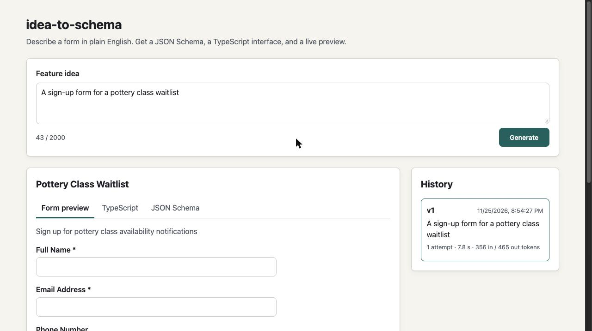

# idea-to-schema

Type a feature idea in plain English, such as "a sign-up form for a pottery class waitlist". You get back a live form preview, a TypeScript interface, a Zod validator, a JSON Schema, and a Postgres `CREATE TABLE` statement. Every generation is saved as a revision you can browse and restore.

Live demo: https://idea-to-schema.unlikelyarchive.workers.dev



## How it works

1. The browser sends your idea to the server.
2. The server asks an AI model (GLM-4.7-Flash on Cloudflare Workers AI) to call one tool, `define_spec`, with a title, a summary, and a list of fields.
3. The server checks that field list against strict rules. If it fails, the model gets the list of errors and one more try.
4. Plain TypeScript functions turn the checked field list into the TypeScript interface, the Zod validator, the JSON Schema, and the SQL table. React renders the form preview from the same list.
5. The result is saved to Postgres as a new revision.

## Run it locally

You need Node 24, Docker, and a free Cloudflare account.

1. Make an API token with the Workers AI permission in the Cloudflare dashboard.
2. Copy `server/.env.example` to `server/.env` and fill in your account ID and token.
3. Start the database, install, and migrate:

   ```sh
   docker compose up -d
   cd server && npm install && npm run db:migrate
   cd ../web && npm install
   ```

4. Start the server and the page in two terminals:

   ```sh
   cd server && npm run dev   # API on http://localhost:3000
   cd web && npm run dev      # page on http://localhost:5173
   ```

Run the tests with `cd server && npm test`. They use a separate `*_test` database and a fake model, so they need Docker running but no Cloudflare token. GitHub Actions runs the same tests, plus type checks, on every push and pull request.

## Deploy

The live site runs on Cloudflare Workers with Postgres on Neon, connected through Hyperdrive. One-time setup, from `server/`:

```sh
npx wrangler login
npx wrangler hyperdrive create idea-to-schema --connection-string="<Neon direct connection string>" --caching-disabled
DATABASE_URL="<same string>" npm run db:migrate
npx wrangler secret put WORKERS_AI_ACCOUNT_ID
npx wrangler secret put WORKERS_AI_API_TOKEN
```

Caching is off because Hyperdrive caches reads for 60 seconds and does not clear them on writes, which would break the idempotency lookup. Then `npm run deploy` builds the page and deploys the Worker. Run `db:migrate` against Neon again whenever a new migration is added.

## Decisions

**The model writes data, not code.** The model never writes TypeScript or JSON Schema. It fills in a field list, and my code turns that list into the outputs. That way the output can't contain broken code, and there is something precise to validate: each key is camelCase and unique, enums have 2–20 options, there are 1–20 fields, and so on. Every rule violation is collected, not just the first.

**One repair retry, then stop.** If the field list fails validation, the server sends the errors back to the model and asks it to fix them. If the second try also fails, the request returns a 422 with the errors and nothing is saved. Two attempts is a hard cap, and a test proves it holds, so a bad model can't loop and run up usage.

**Revisions are append-only.** No revision is ever edited. Restoring an old version inserts a new revision that copies it and records which one it came from. The history is a complete record of what happened, and a restore can never destroy anything.

**Double clicks and races are handled in the database.** Each Generate click sends a unique `Idempotency-Key`. If the same key arrives twice, the server returns the saved revision without calling the model again. If two different requests race to write the same version number, a unique constraint lets only one win, and the other gets a 409 instead of a duplicate.

**Workers AI, because the demo has to cost nothing.** Paid APIs would bill me every time someone tried the live site. Workers AI has a free daily allocation that needs no card, and requests past it fail instead of billing. A free model breaks the rules more often than a frontier model, which is exactly what the validation and retry are for. The model sits behind a small `SpecGenerator` interface, so switching providers means writing one new adapter file. The tests use a fake that implements the same interface.

**Real Postgres in tests.** The idempotency and concurrency rules depend on database constraints, and a mock would not prove that those constraints work. Tests run against a real Postgres locally and in CI.

**The live demo has two limits.** A daily cap of 150 generations keeps it inside the free Workers AI allowance even if every request needs the retry. The cap is counted in Postgres with one atomic statement, so it is exact. A per-IP rate limit of 10 POST requests a minute uses Cloudflare's built-in limiter. That one is approximate, which is fine for slowing down spam, because the cap is the hard guarantee.

**Generated outputs are not stored.** Only the validated field list is saved. The JSON Schema and TypeScript are generated again on every read, so improving a generator updates every old revision too.

## What I'd do next

- **Streaming:** show the result while the model is still writing it, instead of waiting several seconds.
- **Diff view:** compare two revisions side by side.
- **Auth:** accounts, so each person sees only their own specs.
